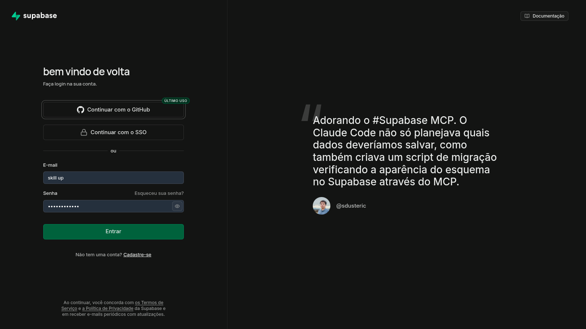
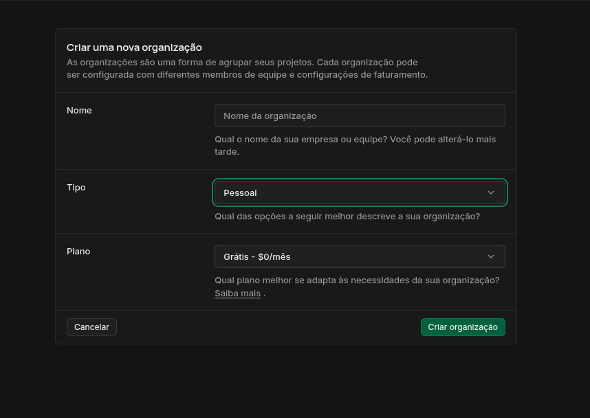
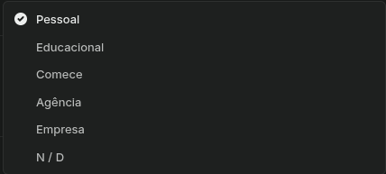
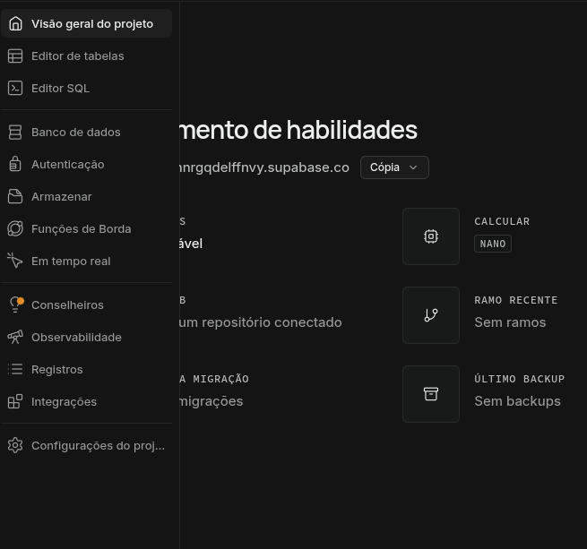

# Crie uma conta

## Crie uma organização

### Para que serve cada tipo?

### Sidebar

---

## 1. Painel Principal e Estrutura

### Visão Geral do Projeto (Project Overview)
Apresenta o painel central da aplicação. Exibe métricas de desempenho do servidor (uso de CPU e memória RAM), endereço de rede para requisições (URL do projeto) e atalhos para integrações com serviços externos.

### Editor de Tabelas (Table Editor)
Interface gráfica para administração e gerenciamento do banco de dados relacional. Permite visualizar dados existentes, criar novas tabelas e modificar colunas sem a necessidade de comandos manuais.

### Editor SQL (SQL Editor)
Console para execução direta de consultas em linguagem SQL (*Structured Query Language*). Útil para criação de rotinas personalizadas, testes de consultas complexas e execução de automações.

---

## 2. Serviços de Backend

### Banco de Dados (Database)
Seção de gestão avançada do banco de dados PostgreSQL. Contém as configurações de segurança no nível de linha (RLS), gatilhos de eventos (*triggers*), rotinas internas (*functions*) e opções de otimização de consultas.

### Autenticação (Authentication)
Gerenciador central do sistema de controle de acesso de usuários. Responsável pelo armazenamento de credenciais, configuração de login por múltiplos provedores (OAuth), validação de sessões e gerenciamento de permissões.

### Armazenar (Storage)
Serviço de hospedagem de arquivos e mídias da aplicação. Organizado por diretórios isolados (*buckets*), permite controlar permissões de envio e leitura de arquivos como imagens, documentos e vídeos.

### Funções de Borda (Edge Functions)
Ambiente para execução de rotinas backend sob demanda (*serverless*). Permite rodar código TypeScript em servidores distribuídos para processamento pesado, integrações com sistemas de pagamento ou envio de notificações.

### Em Tempo Real (Realtime)
Serviço de sincronização contínua via protocolo WebSockets. Permite que a aplicação frontend receba notificações de alteração no banco de dados no momento exato em que ocorrem.

---

## 3. Diagnósticos e Operações

### Conselheiros (Advisors)
Ferramenta automatizada de análise de código e infraestrutura. Identifica falhas de segurança no banco de dados e aponta gargalos que afetam o desempenho das consultas.

### Observabilidade (Observability)
Módulo de monitoramento técnico. Exibe gráficos de requisições por segundo, tempo de resposta do servidor e consumo de recursos da infraestrutura.

### Registros (Logs)
Histórico estruturado de eventos do sistema. Armazena erros de código, tentativas de autenticação e requisições HTTP para auxílio na identificação e correção de falhas.

### Integrações (Integrations)
Central de conexão entre o ambiente Supabase e plataformas de terceiros, como provedores de hospedagem, repositórios e serviços de análise de dados.

---

## 4. Administração do Sistema

### Configurações do Projeto (Project Settings)
Área de gerenciamento técnico do projeto. Contém as chaves de acesso à API (`anon` e `service_role`), credenciais de conexão direta e dados sobre o plano contratado.
