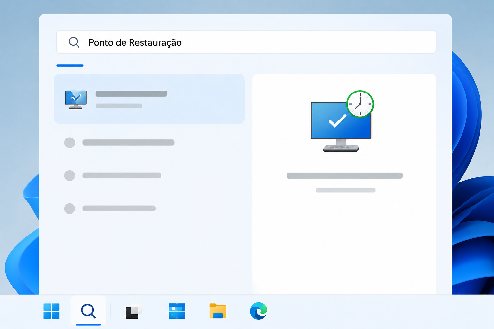
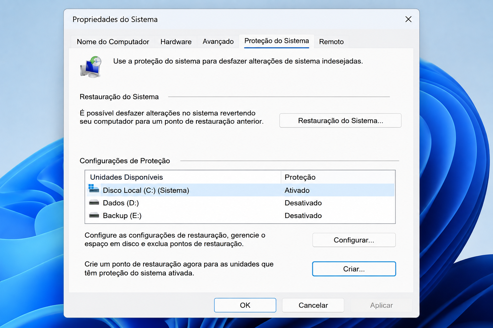
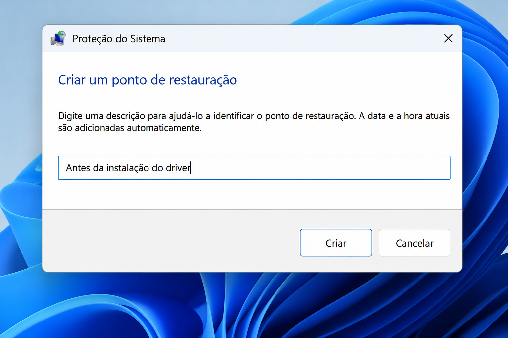
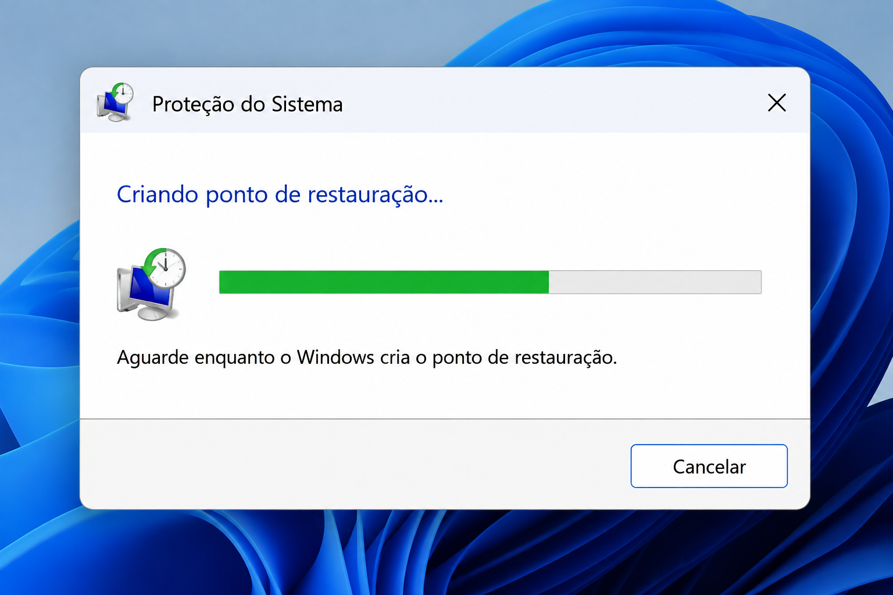
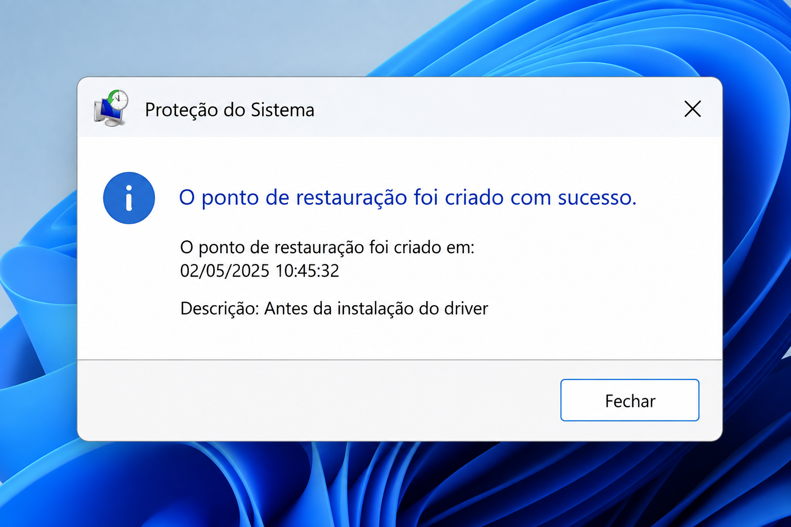

#Ponto de Restauração no Windows

O Ponto de Restauração permite salvar o estado atual do Windows para que seja possível voltar a ele caso alguma alteração, instalação ou configuração cause problemas no sistema.

Como criar um ponto de restauração

1. Abra a Pesquisa do Windows.
2. Pesquise por Ponto de Restauração.
3. Abra Criar um ponto de restauração.
4. Na aba Proteção do Sistema, selecione a unidade onde deseja criar o ponto de restauração.
5. Clique em Criar.
6. Digite um nome para identificar o ponto de restauração.

Exemplo:

Antes da instalação do driver

7. Clique em Criar.
8. Aguarde o Windows confirmar que o ponto de restauração foi criado.

Resumo

Pesquisar "Ponto de Restauração"
        ↓
Selecionar a unidade
        ↓
Clicar em "Criar"
        ↓
Dar um nome
        ↓
Criar o ponto de restauração

Observação

É recomendado criar um ponto de restauração antes de fazer alterações importantes no Windows, como instalação de drivers, mudanças em configurações do sistema ou instalação de programas que possam afetar seu funcionamento.

##Importante: ponto de restauração não substitui um backup dos seus arquivos pessoais.

